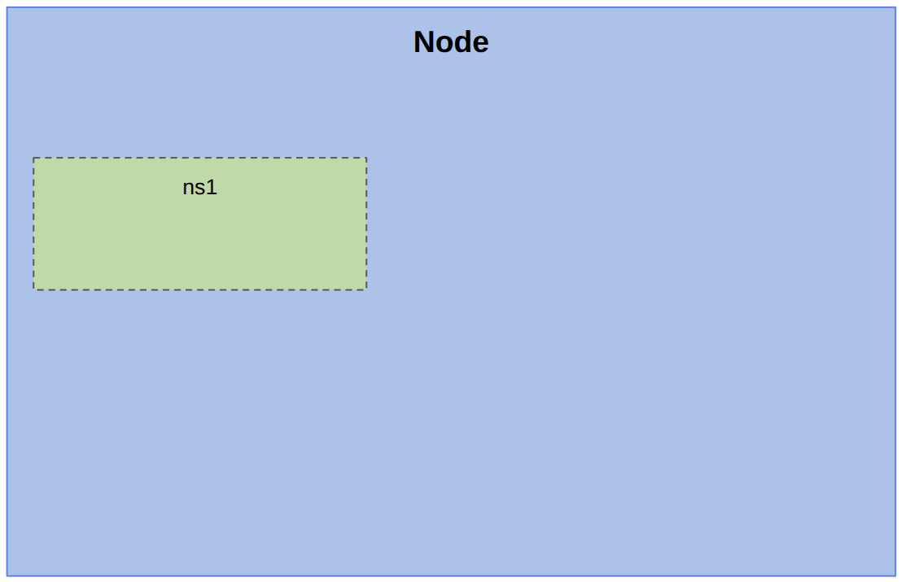

# Creation of the network namespace & Localhost Isolation

In this step, we create an isolated Linux network namespace (`ns1`).
Each network namespace possesses its own independent network stack: loopback interface (`lo`), interfaces, routing table, and socket space.

## What this demo illustrates

**Namespace creation**:
   - `ip netns add ns1`
   
**Localhost isolation**:
   - **Echo server**: Starting a server on `localhost:8080` inside `ns1`.
   - Accessing `http://localhost:8080` from **inside `ns1`** succeeds and returns the echo.
   - Accessing `http://localhost:8080` from the **main host** fails with `Connection refused`, showing that the namespace's `localhost` is completely separate from the host's `localhost`.

```
PS1="\[\e[1m\][demo]$ \[\e[0m\] "
cd /assets/scenarios/01-netns
./demo.sh
``` {{exec hidden=true text="Start demo" target="node"}}


