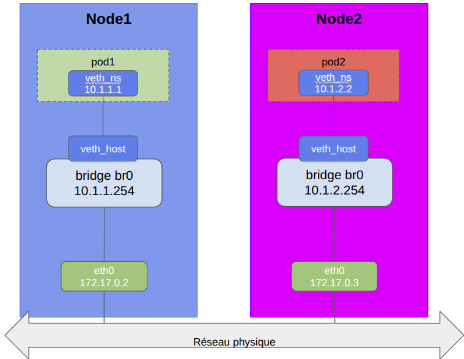
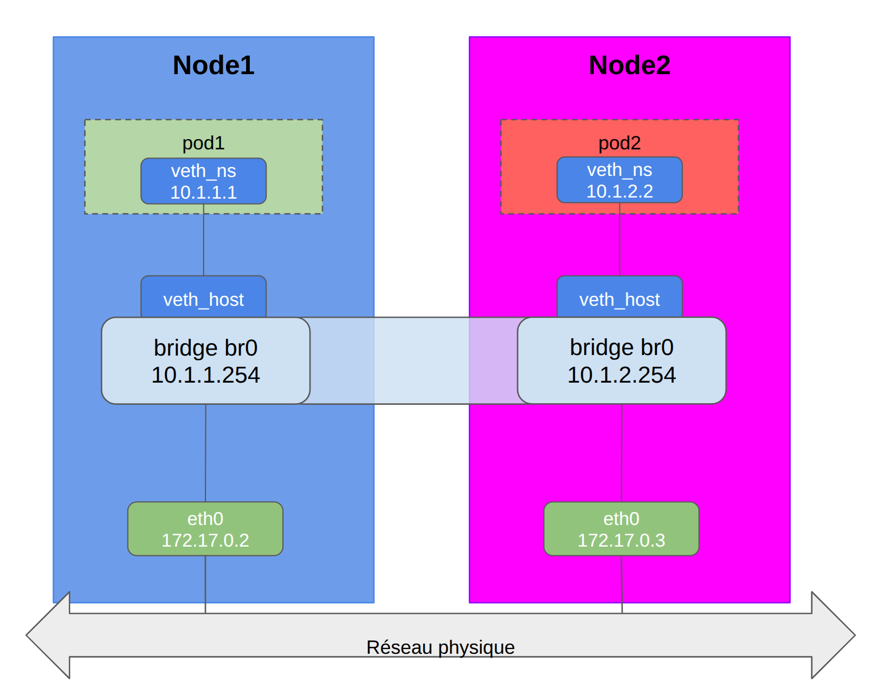
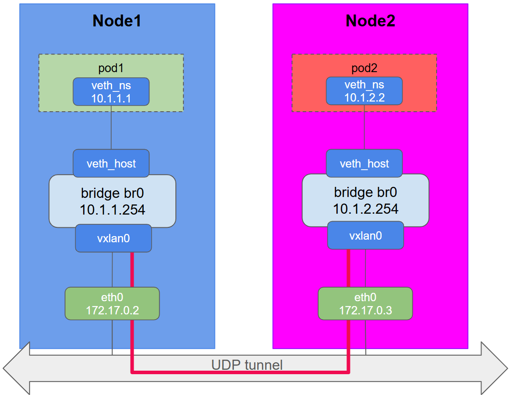

## Connect to node1 and setup namespace

Setup the first node

```
cd /assets/scenarios/06-multi
./06-node1.sh
``` {{exec target=node hidden=true text="Create node1"}}


## Connect to node2 and setup namespace

Setup the node 2
```
cd /assets/scenarios/06-multi
./06-node2.sh
``` {{exec target=ns hidden=true text="Create node2"}}



## Setup the connection across nodes (Overlay Network)

Connect bridges together using a VXLAN overlay network (multicast group `239.1.1.1`).
Any node joining this multicast group joins the same L2 broadcast domain without needing point-to-point mesh tunnels.

> **Why production CNIs avoid multicast:**  
> Multicast is used here because it is simple and doesn't require a central coordinator. However, public clouds (AWS, GCP, Azure) and many enterprise networks block IP multicast.  
> Production Kubernetes CNIs (such as Flannel) avoid multicast by acting as a **unicast control plane**: the CNI daemon watches the Kubernetes API and directly populates kernel routing tables (`ip route`), ARP tables (`ip neigh`), and the VXLAN forwarding database (`bridge fdb`), forwarding packets directly between node IPs via unicast UDP.



## Create the VXLAN overlay between bridges

Encapsulates L2 Ethernet frames into UDP packets (port 4789) sent over multicast group `239.1.1.1`.<br />
Configure VXLAN on node2 and node1:

```
go
``` {{exec target=node hidden=true text="Start"}}



## Check connectivity

Check connectivity between node1 and node2

```
go
``` {{exec target=ns hidden=true text="Start"}}

## Add a third node (Scaling the Overlay)

To see the power of multicast over point-to-point mesh:  
Connect to **node3** (represented in **cyan** with **yellow** for `pod3`), configure its bridge, and join the exact same multicast group `239.1.1.1`.

Notice that **Node 1 and Node 2 require zero modifications**:

```
cd /assets/scenarios/06-multi
./06-node3.sh
``` {{exec target=ns hidden=true text="Create node3"}}


