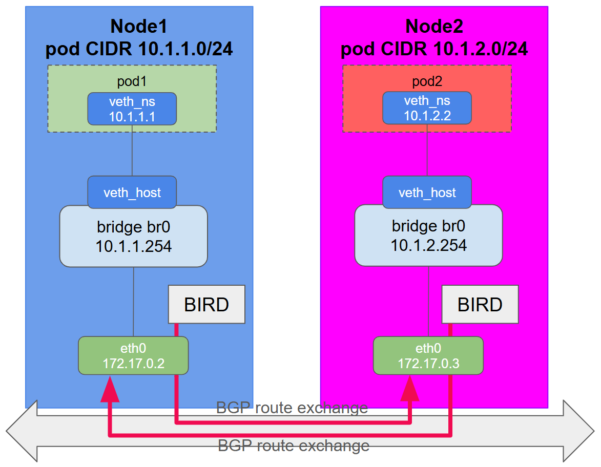

# Dynamic Routing with BGP (Annex)

In **Step 8**, we connected two nodes using **Layer 3 static routes**.  
While this works for 2 nodes, managing static routes across a cluster of 50 or 100 nodes becomes impossible.

In production Kubernetes environments, CNIs like **Project Calico** and **Cilium** solve this using **BGP (Border Gateway Protocol)**:
- Each node runs a lightweight BGP routing daemon (such as **BIRD**).
- Nodes automatically peer with one another over the physical/underlay network.
- When a pod subnet is assigned to a node, BGP advertises it to all peer nodes.
- Peer nodes receive the advertisement and automatically program the route (`proto bird`) into their Linux kernel routing table.

In this scenario, we use **BIRD 2** to automate the route exchange between `node1`, `node2`, and `node3`.

---

## Connect to node1 and start BGP



Setup node1 (`10.1.1.0/24`), inspect its BIRD configuration, and start the daemon:

```
cd /assets/scenarios/09-bgp
./09-node1.sh
``` {{exec target=node hidden=true text="Create node1"}}


## Connect to node2, inspect failure and start BGP

On node2, verify that `pod2` initially cannot reach `pod1`, then start BIRD:

```
cd /assets/scenarios/09-bgp
./09-node2.sh
``` {{exec target=ns hidden=true text="Create node2"}}


## Verify BGP peering on Node1

Switch back to node1 to verify that the BGP session is **Established** and that `10.1.2.0/24` has been injected into `ip route`:

```
go
``` {{exec target=node hidden=true text="Start"}}


## Connect to node3 and verify mesh convergence

To demonstrate how BGP scales automatically when adding new nodes, connect to `node3`:

```
cd /assets/scenarios/09-bgp
./09-node3.sh
``` {{exec target=ns hidden=true text="Create node3"}}

